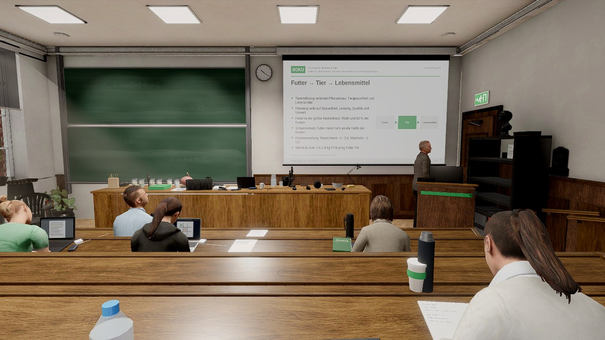
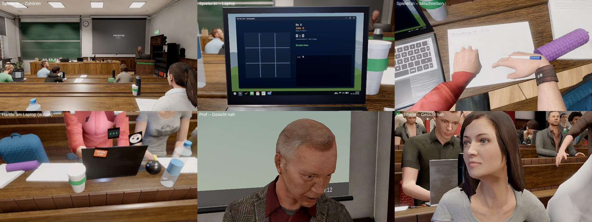
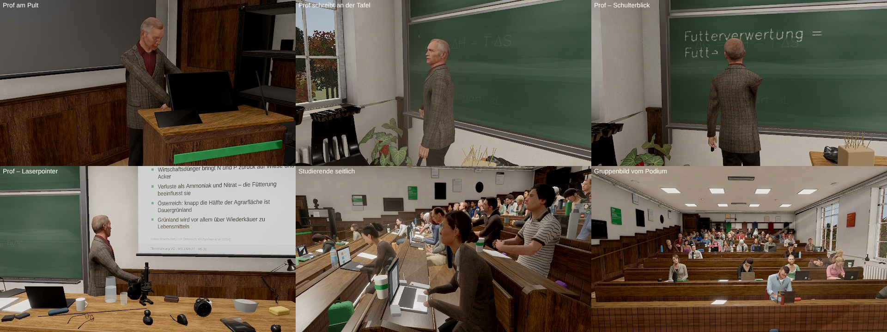
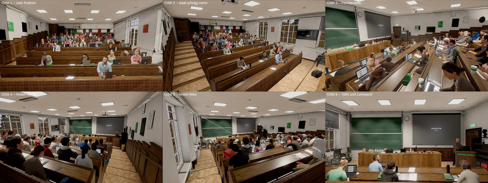
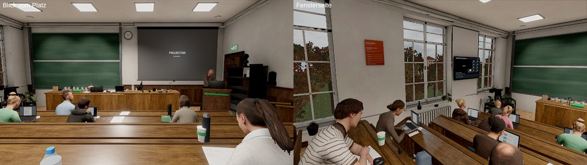

# Tic Tac Tierernährung 3 🐄 ✕ ◯

Ein 3D-Ego-Spiel im Browser. Dienstag, 10 Uhr, **Hörsaal 31 im Gregor-Mendel-Haus** der BOKU (Universität für Bodenkultur Wien),
Bachelor Agrarwissenschaften, Vorlesung **Tierernährung**. Prof. Haferkorn erklärt Weender Analyse, Pansenphysiologie und
Rationsberechnung – du sitzt in Reihe 5 und spielst heimlich Tic Tac Toe gegen eine Studentin zwei Reihen weiter vorne.
Lass dich nicht erwischen.

> **Fan-Projekt, kein offizielles Angebot der BOKU.** Es werden keine Logos oder Fotos der BOKU verwendet; Website-Optik und Hörsaal
> sind nachempfunden. Prof. Haferkorn und alle Studierenden sind frei erfunden. Die Fachinhalte sind recherchiert (Quellen in
> `docs/RECHERCHE.md`), ersetzen aber keine Lehrveranstaltung.



## Spielen

**Am einfachsten – im Browser, ohne Download** (Computer und Handy):
**https://konvalinaalexander-max.github.io/spiel/** (Handy-Fassung, auch am Computer spielbar) bzw.
**https://konvalinaalexander-max.github.io/spiel/BOKU_TicTacTierernaehrung_v3.html** (Computer, volle Qualität).
Voraussetzung (einmalig, durch die Besitzerin bzw. den Besitzer des Repositorys): *Settings → Pages → Build and deployment →
Source: „GitHub Actions“*. Danach veröffentlicht der Workflow `.github/workflows/pages.yml` bei jedem Push automatisch
(oder sofort über *Actions → Pages → Run workflow*).

**Offline am Computer (Download):**

1. Aus `dist/` die Datei `BOKU_TicTacTierernaehrung_v3.html` herunterladen (auf GitHub: Datei öffnen → „Download raw file“),
   für die deutsche Stimme zusätzlich `BOKU_TicTacTierernaehrung_v3_stimme_de.js` in **denselben Ordner** (Englisch:
   `…_stimme_en.js`). Ohne Stimmdatei läuft das Spiel auch, dann mit Untertiteln.
2. Die HTML-Datei per Doppelklick öffnen (Chrome, Edge, Firefox, Safari; WebGL 2).
3. „Zur Lehrveranstaltung“ → Schwierigkeit, Modus, Dauer, Sitzplatz wählen → „Vorlesung betreten“.

**Am Handy** über die Pages-Adresse oben (installierbar als App, offline nach dem ersten Start) oder
das ZIP `BOKU_TicTacTierernaehrung_v3_mobile.zip` auf einem eigenen HTTPS-Server (liegt auf der Pages-Seite unter
`…/spiel/BOKU_TicTacTierernaehrung_v3_mobile.zip` oder entsteht lokal mit `npm run build:mobile`; mit 96 MB nicht im Repository). Details und Touch-Steuerung: `docs/MOBILE.md`.

Version 2 liegt unverändert als `dist/BOKU_TicTacTierernaehrung_v2.html` bei. Prüfsummen: `dist/SHA256.txt`.

### Steuerung

| Eingabe | Aktion |
|---|---|
| Maus / Pfeiltasten / WASD | umschauen (Zuhör-Modus) |
| `Leertaste` / rechte Maustaste | zum Laptop beugen ↔ aufschauen |
| Maus + Klick, Ziffernblock `1`–`9` | am Laptop: Feld setzen, Fenster bedienen |
| `N` (halten) | mitschreiben |
| `F` (halten) | genau hinschauen: zoomt auf Tafel und Folien (≈ 2,4-fach), damit man den Stoff auch aus den hinteren Reihen lesen kann |
| `Tab` | zwischen Spiel und Skriptum wechseln (Reflexzeit 0,3 s) |
| Mausrad / `L` | Deckelwinkel (flacher = weniger Leuchten, schwerer lesbar) |
| `+` / `−` | Bildschirmhelligkeit |
| `H` / `M` | Kopfhörer · Laptop stumm |
| `E` | Exkursionsliste unterschreiben (Mausgeste) |
| `1`–`4`, `R` | Prüfungsfrage beantworten · Blick in die Mitschrift |
| `Esc` / `P`, `F1`, `F3` | Pause („Mensa-Pause“), Hilfe, Sicht des Profs (Debug) |
| Gamepad | Stick: Blick/Cursor · A: Klick · B: Laptop · X halten: mitschreiben · LT: genau hinschauen · Y: Fenster · LB/RB: Deckel · Steuerkreuz: Feld |
| Touch | Ziehen: Blick/Cursor · Tippen: Klick · zwei Finger auseinander: genau hinschauen · zwei Finger nach unten: Deckel · Tastenleiste unten (siehe `docs/MOBILE.md`) |

Alle Tasten sind in den Einstellungen frei belegbar.

### Regeln in Kürze

- **Aufmerksamkeit → Verdacht → Beweis:** Bewegung, Bildschirmleuchten und gesenkter Kopf fallen dem Prof auf – auch aus dem Augenwinkel.
  Schaut er bewusst hin, wächst der Verdacht; nur ein direkter Blick auf den Laptop mit offenem Spiel erzeugt Beweis. Bei 100 % bist du erwischt.
- Vorderleute verdecken dich. Hinten ist es sicherer, vorne gibt es mehr Punkte (Platzfaktor).
- Hört das Kreidekratzen auf, dreht er sich gleich um – manchmal blufft er nur. Deine Sitznachbarin warnt dich (je nach Schwierigkeit).
- 1. und 2. Mal erwischt: Ermahnung, danach schaut er dich öfter an. 3. Mal: Hörsaalverweis – oder, wenn du fleißig mitgeschrieben bzw.
  Fragen richtig beantwortet hast, Umsetzen in die erste Reihe.
- Am Ende: Zeugnis mit Note 1–5 (österreichisches System), Punkteaufschlüsselung, Erfolge, lokale Bestenliste.

### Systemanforderungen

- Browser mit WebGL 2 (Chrome/Edge ≥ 90, Firefox ≥ 90, Safari ≥ 15). Keine Installation, keine Internetverbindung nötig.
- „Niedrig“ läuft auf einfacher integrierter Grafik; „Mittel“ ist für aktuelle integrierte Grafik (z. B. Intel Iris Xe) ausgelegt,
  „Hoch/Ultra“ für dedizierte GPUs. Die Stufe wird automatisch gewählt und kann in den Einstellungen geändert werden
  (Messwerte und Grenzen: `docs/PERFORMANCE.md`).
- Echte, vorgerenderte Stimmen (Deutsch vollständig: Coqui XTTS v2; Englisch als Textfassung mit Kokoro-82M-Aufnahmen) und echte
  Geräuschaufnahmen; Untertitel gibt es immer.
- Menschen: Microsoft Rocketbox (MIT) mit Motion-Capture-Animationen; Gesichter von Prof, Nachbarin und Tutorin mit Mundformen.

## Entwickeln

```bash
npm install                  # three, postprocessing, n8ao, esbuild, sharp, gltf-transform, meshoptimizer, ktx2-encoder …
npm run build                # Desktop (dist/…_v3.html + Stimmen-Begleitdateien) und Mobil (dist/mobile/ + ZIP)
npm run build:desktop        # nur Desktop
npm run build:mobile         # nur Mobil
npm test                     # Unit- und Integrationstests (+ --e2e für den Headless-Browserlauf)
node tools/sim.mjs --runs 80 --difficulty all            # Bot-Balancing
node tools/sharpness.mjs --label v3                      # Schärfe- und Lesbarkeitsmessung (docs/SCHAERFE.md)
node tools/audio-check.mjs                               # Pegel, Rauschen, Synthese-Reste
```

Die Assets (Figuren, Materialien, Requisiten, Stimmen, Geräusche) liegen verarbeitet in `assets/build/`. Wie sie aus den freien
Quellen entstehen und wie man sie neu erzeugt, steht in `docs/PIPELINE.md`.

Der Build ist reproduzierbar (feste Paketversionen in `package-lock.json`); nur der Zeitstempel im Bundle ändert sich.

### Architektur

```
src/
  main.js            Start, Laden, Menü ↔ Spiel ↔ Pause ↔ Zeugnis, Hauptschleife
  core/              Hilfsfunktionen (Zufall, Dämpfung, Speicher, Ereignisbus), Eingabe (Maus/Pointer Lock, Tastatur, Gamepad, Touch)
  gfx/               Renderer, Post-Stack, Kaskadenschatten, Qualitätsstufen, GPU-Texturgeneratoren (GLSL), Geometrie-Batching
  scene/             Hörsaal (Maße in layout.js), Tafeln (Kreidepfade), Folien, Beamer, Licht, Außenwelt, Requisiten
  chars/             Figuren (Rocketbox: humans.js/humanPack.js, clipCharacter.js = Motion Capture + Blick/IK/Griffe/Gesicht),
                     Prof, Studierende, eigener Körper/Kamera; ältere MakeHuman-/prozedurale Figuren als Rückfall
  game/              Session (Logik), Vorlesungs-Director, Prof-KI, Sichtmodell, Verdacht, Tic Tac Toe, Gegner:in, Bot, Welt-Aufbau
  laptop/os.js       Studierenden-Desktop als Bildschirmtextur (Tic Tac Toe, Snake, Skriptum, BOKUlearn, Mail)
  ui/                Menüs im BOKU-Stil, HUD, Übersetzung, Design-Tokens (tokens.css)
  audio/             echte Geräusche (sfx.js), vorgerenderte Stimmen (voice.js), Mixer, Hall; Synthese nur für 5 Laptop-Signaltöne
  content/           15 Vorlesungsabschnitte (JSON, DE/EN), Dialoge, UI-Texte DE/EN
tools/               build (+ build-mobile), test, sim (Bot), sharpness, audio-check, e2e/docshots, validate-content
  pipeline/          Asset-Pipeline: Figuren (Rocketbox: people-fetch.py, people.mjs, hair.mjs), Materialien, Requisiten (+ Atlas),
                     Licht (Cycles-Lightmaps), Lizenzliste
  voice/, audio/     Sprachsynthese (Korpus, Normalisierung, Rendern, Mastering), Geräusch-Aufbereitung
docs/                Recherche, Iterationen, Performance, Balancing, Audio, Changelog, Abschluss, Screenshots, RUN_LOG
```

Die Spiellogik (`src/game/*`) ist DOM- und renderfrei und läuft identisch im Browser und in Node (Bot-Simulation, Tests).

## Bilder

| | |
|---|---|
|  |  |
|  |  |

Gerendert mit `tools/sheet.mjs` (Stufe „Mittel“, Software-Renderer); auf einem Grafikchip identisch, nur schneller.

## Lizenzen

- Spiel-Code und Inhalte: MIT.
- [three.js](https://threejs.org) r183 – MIT · [postprocessing](https://github.com/pmndrs/postprocessing) – Zlib ·
  [N8AO](https://github.com/N8python/n8ao) – CC0 · [Work Sans](https://github.com/weiweihuanghuang/Work-Sans) – SIL OFL 1.1.
- Figuren und Bewegungen: Microsoft Rocketbox Avatar Library (MIT, © 2020 Microsoft; Lizenztext `docs/licenses/`),
  Materialien: ambientCG (CC0), Requisiten: Poly Haven (CC0).
- Geräusche: CC0, Public Domain und CC BY (Nennung im Spiel und in `docs/AUDIO_QUELLEN.md`); Musik: Kevin MacLeod (CC BY 4.0).
- Stimmen: Coqui XTTS v2 (Coqui Public Model License, nicht-kommerziell) und Kokoro-82M (Apache-2.0), synthetische Sprecher:innen.
- Vollständige Liste mit Prüfsummen: `docs/ASSETS.md`; im Spiel unter „Impressum, Quellen & Lizenzen“.

## Dokumentation

`docs/ABSCHLUSS_V3.md` (Stand, Nachweise, To-dos) · `docs/SCHAERFE.md` · `docs/MOBILE.md` · `docs/PIPELINE.md` · `docs/ASSETS.md` ·
`docs/AUDIO.md` · `docs/AUDIO_QUELLEN.md` · `docs/DIALOG.md` · `docs/BALANCING.md` · `docs/PERFORMANCE.md` · `docs/CHANGELOG.md` ·
`docs/RECHERCHE.md` · `docs/ITERATIONEN.md` · `docs/screenshots/`
