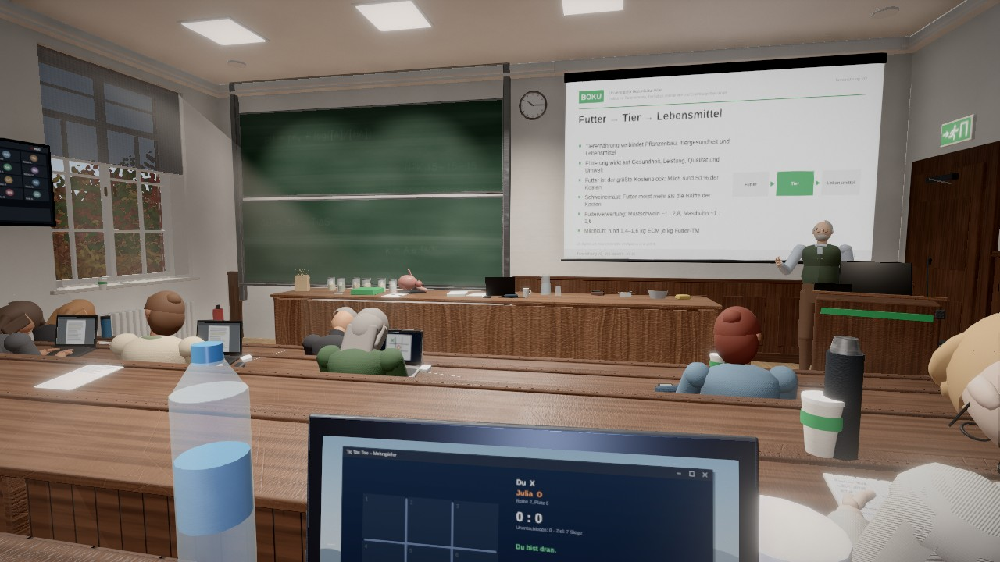

# Tic Tac Tierernährung 2 🐄 ✕ ◯

Ein 3D-Ego-Spiel im Browser. Dienstag, 10 Uhr, **Hörsaal 31 im Gregor-Mendel-Haus** der BOKU (Universität für Bodenkultur Wien),
Bachelor Agrarwissenschaften, Vorlesung **Tierernährung**. Prof. Haferkorn erklärt Weender Analyse, Pansenphysiologie und
Rationsberechnung – du sitzt in Reihe 5 und spielst heimlich Tic Tac Toe gegen eine Studentin zwei Reihen weiter vorne.
Lass dich nicht erwischen.

> **Fan-Projekt, kein offizielles Angebot der BOKU.** Es werden keine Logos oder Fotos der BOKU verwendet; Website-Optik und Hörsaal
> sind nachempfunden. Prof. Haferkorn und alle Studierenden sind frei erfunden. Die Fachinhalte sind recherchiert (Quellen in
> `docs/RECHERCHE.md`), ersetzen aber keine Lehrveranstaltung.



## Spielen

1. **`dist/BOKU_TicTacTierernaehrung_v2.html`** herunterladen (eine Datei, ≈ 2,1 MB, alles eingebettet – läuft offline).
2. Per Doppelklick in einem aktuellen Browser öffnen (Chrome, Edge, Firefox, Safari; WebGL 2 nötig).
3. „Zur Lehrveranstaltung“ → Schwierigkeit, Modus, Dauer, Sitzplatz wählen → „Vorlesung betreten“.

Prüfsumme: `dist/SHA256.txt`.

### Steuerung

| Eingabe | Aktion |
|---|---|
| Maus / Pfeiltasten / WASD | umschauen (Zuhör-Modus) |
| `Leertaste` / rechte Maustaste | zum Laptop beugen ↔ aufschauen |
| Maus + Klick, Ziffernblock `1`–`9` | am Laptop: Feld setzen, Fenster bedienen |
| `N` (halten) | mitschreiben |
| `F` (halten) | genau hinschauen: zoomt auf Tafel und Folien (≈ 2,4-fach), damit man den Stoff auch aus den hinteren Reihen lesen kann |
| `Tab` | zwischen Spiel und Skriptum wechseln (Reflexzeit 0,3 s) |
| Mausrad / `L` | Deckelwinkel (flacher = weniger Leuchten, schwerer lesbar) |
| `+` / `−` | Bildschirmhelligkeit |
| `H` / `M` | Kopfhörer · Laptop stumm |
| `E` | Exkursionsliste unterschreiben (Mausgeste) |
| `1`–`4`, `R` | Prüfungsfrage beantworten · Blick in die Mitschrift |
| `Esc` / `P`, `F1`, `F3` | Pause („Mensa-Pause“), Hilfe, Sicht des Profs (Debug) |
| Gamepad | Stick: Blick/Cursor · A: Klick · B: Laptop · X halten: mitschreiben · LT: genau hinschauen · Y: Fenster · LB/RB: Deckel · Steuerkreuz: Feld |
| Touch | Wischen: Blick/Cursor · Tippen: Klick · Schaltflächen unten rechts |

Alle Tasten sind in den Einstellungen frei belegbar.

### Regeln in Kürze

- **Aufmerksamkeit → Verdacht → Beweis:** Bewegung, Bildschirmleuchten und gesenkter Kopf fallen dem Prof auf – auch aus dem Augenwinkel.
  Schaut er bewusst hin, wächst der Verdacht; nur ein direkter Blick auf den Laptop mit offenem Spiel erzeugt Beweis. Bei 100 % bist du erwischt.
- Vorderleute verdecken dich. Hinten ist es sicherer, vorne gibt es mehr Punkte (Platzfaktor).
- Hört das Kreidekratzen auf, dreht er sich gleich um – manchmal blufft er nur. Deine Sitznachbarin warnt dich (je nach Schwierigkeit).
- 1. und 2. Mal erwischt: Ermahnung, danach schaut er dich öfter an. 3. Mal: Hörsaalverweis – oder, wenn du fleißig mitgeschrieben bzw.
  Fragen richtig beantwortet hast, Umsetzen in die erste Reihe.
- Am Ende: Zeugnis mit Note 1–5 (österreichisches System), Punkteaufschlüsselung, Erfolge, lokale Bestenliste.

### Systemanforderungen

- Browser mit WebGL 2 (Chrome/Edge ≥ 90, Firefox ≥ 90, Safari ≥ 15). Keine Installation, keine Internetverbindung nötig.
- „Niedrig“ läuft auf einfacher integrierter Grafik; „Mittel“ ist für aktuelle integrierte Grafik (z. B. Intel Iris Xe) ausgelegt,
  „Hoch/Ultra“ für dedizierte GPUs. Die Stufe wird automatisch gewählt und kann in den Einstellungen geändert werden
  (Messwerte und Grenzen: `docs/PERFORMANCE.md`).
- Sprachausgabe über die Stimmen des Betriebssystems (de-AT bevorzugt); ohne Stimmen murmelt der Prof, Untertitel gibt es immer.

## Entwickeln

```bash
npm install          # three, postprocessing, n8ao, hersheytext, @fontsource/work-sans, esbuild
npm run build        # → dist/BOKU_TicTacTierernaehrung_v2.html + dist/SHA256.txt
npm test             # Unit- und Integrationstests (+ --e2e für den Headless-Browserlauf)
node tools/sim.mjs --runs 80 --difficulty all --md docs/BALANCING.md   # Bot-Balancing
node tools/e2e.mjs --steps game,sim60,listen,laptop                    # Headless-Durchlauf mit Screenshots
```

Der Build ist reproduzierbar (feste Paketversionen in `package-lock.json`); nur der Zeitstempel im Bundle ändert sich.

### Architektur

```
src/
  main.js            Start, Laden, Menü ↔ Spiel ↔ Pause ↔ Zeugnis, Hauptschleife
  core/              Hilfsfunktionen (Zufall, Dämpfung, Speicher, Ereignisbus), Eingabe (Maus/Pointer Lock, Tastatur, Gamepad, Touch)
  gfx/               Renderer, Post-Stack, Kaskadenschatten, Qualitätsstufen, GPU-Texturgeneratoren (GLSL), Geometrie-Batching
  scene/             Hörsaal (Maße in layout.js), Tafeln (Kreidepfade), Folien, Beamer, Licht, Außenwelt, Requisiten
  chars/             Skelett-Rig + Figuren, Prof-Darstellung, Studierende, eigener Körper/Kamera
  game/              Session (Logik), Vorlesungs-Director, Prof-KI, Sichtmodell, Verdacht, Tic Tac Toe, Gegner:in, Bot, Welt-Aufbau
  laptop/os.js       Studierenden-Desktop als Bildschirmtextur (Tic Tac Toe, Snake, Skriptum, BOKUlearn, Mail)
  ui/                Menüs im BOKU-Stil, HUD, Übersetzung, Design-Tokens (tokens.css)
  audio/             prozedurale Klangsynthese, Mixer, Hall, Sprachausgabe
  content/           15 Vorlesungsabschnitte (JSON, DE/EN), Dialoge, UI-Texte DE/EN
tools/               build, test, sim (Bot), e2e/docshots/phaseshots (Headless-Screenshots), validate-content
docs/                Recherche, Iterationen, Performance, Balancing, Audio, Changelog, Abschluss, Screenshots, RUN_LOG
```

Die Spiellogik (`src/game/*`) ist DOM- und renderfrei und läuft identisch im Browser und in Node (Bot-Simulation, Tests).

## Lizenzen

- Spiel-Code und Inhalte: MIT.
- [three.js](https://threejs.org) r183 – MIT · [postprocessing](https://github.com/pmndrs/postprocessing) – Zlib ·
  [N8AO](https://github.com/N8python/n8ao) – CC0 · [hersheytext](https://github.com/techninja/hersheytext) (Hershey-Schriften, frei) – MIT ·
  [Work Sans](https://github.com/weiweihuanghuang/Work-Sans) – SIL OFL 1.1.
- Vollständige Lizenzhinweise im Spiel unter „Impressum, Quellen & Lizenzen“ und in `tools/THIRD_PARTY.txt`.

## Dokumentation

`docs/RECHERCHE.md` · `docs/ITERATIONEN.md` · `docs/PERFORMANCE.md` · `docs/BALANCING.md` · `docs/AUDIO.md` · `docs/CHANGELOG.md` ·
`docs/ABSCHLUSS.md` · `docs/RUN_LOG.txt` · `docs/screenshots/`
